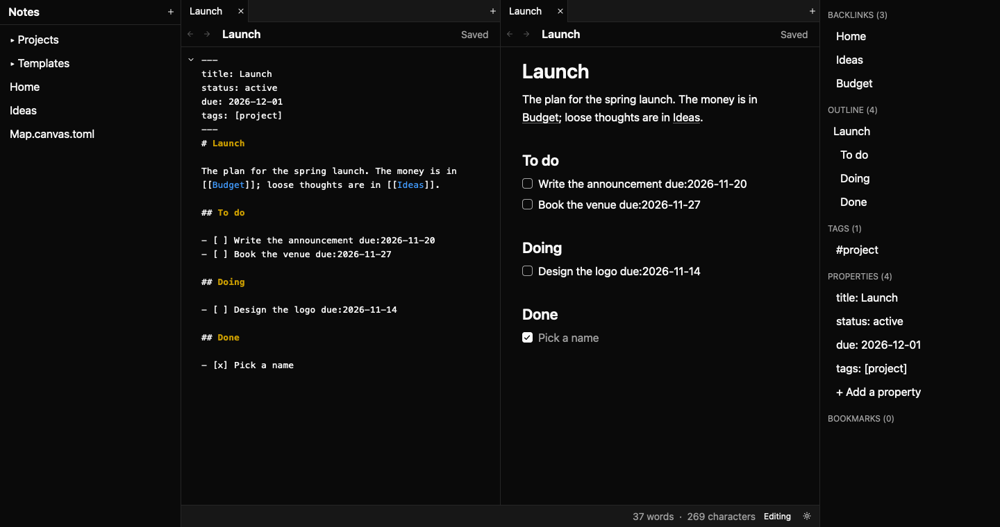

# Diamond

A Markdown knowledge-base app for macOS and Linux. Notes are plain Markdown
files in a folder, linked to each other with `[[wikilinks]]`, with the tools
to write, find and connect them.

Diamond is a native app written in Rust and drawn on the GPU with
[GPUI](https://www.gpui.rs). There is no web view in it. It is MIT licensed.



**Status:** in development. Nothing is released yet, so you build it from
source. This is the `desktop-rewrite` branch; `main` still holds the
project's earlier web app, which this replaces.

## Try it

```sh
cargo run -p diamond-app -- sample-vault
```

That opens the small vault in this repository, which has a note for each
thing worth trying. Press **Cmd-Shift-P** (Ctrl-Shift-P on Linux) for every
command and its shortcut.

Without a folder, Diamond reopens the last vault, or asks for one the first
time.

### What you need

- **Rust**, from [rustup](https://rustup.rs). It reads the version to use
  from `rust-toolchain.toml`.
- **macOS:** Xcode. Its command line tools alone may be enough; that has
  not been tried.
- **Linux:** the libraries GPUI builds against. On Ubuntu 24.04, which is
  what CI uses:

  ```sh
  sudo apt-get install --no-install-recommends \
    build-essential clang cmake pkg-config \
    libasound2-dev libfontconfig-dev libfreetype-dev libssl-dev \
    libvulkan-dev libwayland-dev libx11-dev libx11-xcb-dev \
    libxcb1-dev libxkbcommon-dev libxkbcommon-x11-dev libzstd-dev
  ```

The first build takes several minutes: it compiles the UI framework.

## What it does

- Notes in tabs and side-by-side panes, saved as you type
- Links between notes, backlinks, tags and an outline that follows the editor
- Go to a note by name, and full-text search with `tag:` and `path:` filters
- A rendered reading view, and a live preview beside the editor
- Rename or move a note or folder, with every link to it rewritten
- Daily notes, and templates with date placeholders
- Properties shown and edited beside the note
- Tasks from every note in one list, with due dates
- Queries: tables computed from notes and their properties
- A calendar of daily notes, a graph of links, boards and canvases
- Table commands, bookmarks, and versions and sync through git
- Pictures open in a tab; other files open in their own app
- Changes made by other programs show up live, and never cost you an edit
- Light and dark appearance

Not there yet: Markdown rendered in place as you type (the preview sits
beside the editor for now), a settings screen, and packaged releases. The
full list is at the end of [the guide](docs/guide.md#not-built-yet).

## Documentation

- **[docs/guide.md](docs/guide.md)**: how to use Diamond. Every command and
  shortcut, the syntax for links, search, templates, tasks and queries, and
  the settings files.
- **[docs/architecture.md](docs/architecture.md)**: how the code is laid
  out, the plugin interface, performance, testing, and what is planned.
- **[CONTRIBUTING.md](CONTRIBUTING.md)**: the rules for changes.
- **[SECURITY.md](SECURITY.md)**: what the app can touch, and how to report
  a problem.

## Layout

```
crates/
  diamond-vault   file access: safe paths, atomic writes, watching
  diamond-parse   what a note contains: links, tags, headings, properties
  diamond-index   the vault as a whole: link resolution, search, queries
  diamond-app     the desktop app (binary: diamond)
sample-vault/     a vault to try the app on
docs/             the guide and the architecture
scripts/          release-age.py, the dependency cooling-off check
```

## Development

```sh
cargo fmt --all -- --check
cargo clippy --workspace --all-targets --locked -- -D warnings
cargo test --workspace --locked
```

CI runs the same three on macOS and Linux. The window tests run headless,
so none of this needs a display.

To see how the window looks without opening it, on macOS:

```sh
cargo run -p diamond-app --features screenshots -- --screenshots sample-vault pictures
```

That draws the app's views off screen and saves a picture of each. The
picture at the top of this page is one of them.

## License

MIT. See [LICENSE](LICENSE) and [ACKNOWLEDGMENTS.md](ACKNOWLEDGMENTS.md).
